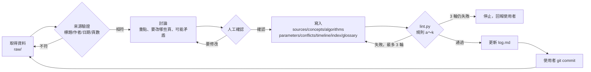
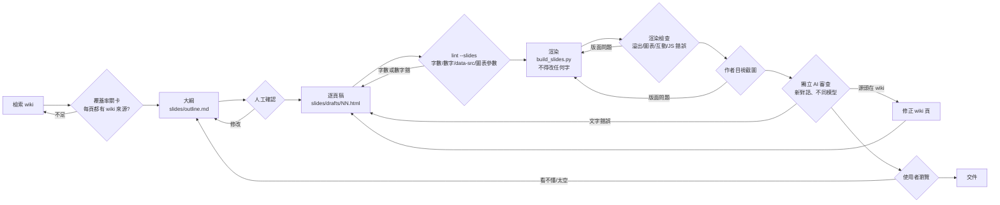

# TCP 壅塞控制 LLM Wiki × 教學 HTML 簡報

>
> - **教學簡報**：<https://claireo6.github.io/tcp-wiki/slides/>
> - **LLM Wiki 入口**：[wiki/index.md](wiki/index.md)
> - **Loop／Graph 設計**：見下方第 3 節與 [AGENTS.md](AGENTS.md)
> - **執行與檢查紀錄**：[wiki/log.md](wiki/log.md)、[reports/](reports/)
> - **獨立 AI 審查報告**：[reports/review-20261122-gemini.md](reports/review-20261122-gemini.md)

---

## 1. LLM Wiki 主題與簡介

**主題：TCP 壅塞控制（TCP Congestion Control）**

這個 Wiki 依照 Karpathy 的 LLM Wiki 構想建立：原始資料放在 `raw/`，由 AI 逐篇消化（ingest）成互相連結的 Markdown 頁面，所有內容都必須能追溯回原始文獻。

### 建立方式：先討論、後生成
1. AI 先**一次一題地訪談我** 9 個問題（讀者、頁面類型、語言、出處粒度、矛盾處理、ingest 節奏、產出、lint 規則、AGENTS.md 形式），整理成需求摘要，我確認後才生成 `AGENTS.md` 與資料夾。
2. 我**逐條對照**需求摘要與 AGENTS.md，找出 6 個問題（例如 lint 失敗時沒有停止條件、「模糊比對」與「精確匹配」互相矛盾），修正後才開始。修正前後的差異保存在 git 歷史（`AGENTS.md v1` → `v2`）。
3. 每一篇文獻都走固定循環：**來源驗證 → 討論 → 我確認 → 寫入 → lint → log → 我 commit**，所以每篇都留下一個 commit。

### 收錄的 6 份原始文獻
| 文獻 | 類型 | 在 Wiki 中的角色 |
| :--- | :--- | :--- |
| Jacobson & Karels 1988〈Congestion Avoidance and Control〉 | 學術論文 | 起點：1986 壅塞崩潰、slow start、AIMD |
| RFC 5681〈TCP Congestion Control〉 | Standards Track | 四個核心演算法的現行標準 |
| RFC 6582〈The NewReno Modification…〉 | Standards Track | partial ACK、Reno 名稱由來 |
| RFC 6928〈Increasing TCP's Initial Window〉 | Experimental | IW10 實驗性提案 |
| RFC 9438〈CUBIC for Fast and Long-Distance Networks〉 | Standards Track，Updates 5681 | CUBIC |
| Cardwell et al. 2017〈BBR: Congestion-Based Congestion Control〉 | 期刊文章 | 以量測取代遺失信號 |

（兩篇論文有版權，PDF在本機、未上傳；4 份 RFC 可公開。）

### Wiki 結構（共 21 頁）
```
wiki/
├── index.md         目錄
├── log.md           每次 ingest／修改／檢查的紀錄
├── glossary.md      詞彙表 + 禁用詞（擁塞→壅塞、帶寬→頻寬…）
├── timeline.md      演進時間軸（只記錄有正式 Updates/Obsoletes 關係的演進）
├── parameters.md    所有數字的索引，每個都附出處
├── conflicts.md     文獻之間說法不同的地方（7 筆）
├── sources/         每份文獻一頁摘要（6 頁）
├── concepts/        機制頁（5 頁）
└── algorithms/      演算法頁（Reno、NewReno、CUBIC、BBR）
```

**設計上特別考量的事**
- **出處要細到章節**：例如 `[RFC 5681 §3.1]`、`[Jacobson 1988, §B, p.20]`；關鍵定義附英文原句，且原句必須和 `raw/` 原文完全一致。
- **矛盾不擅自選邊**：以 RFC 標頭的 `Updates`／`Obsoletes` 欄位作為客觀依據。有正式關係就是「演進」，沒有就記錄到 `conflicts.md`，兩方都列出來源。
- **名稱也需要出處**：raw/ 中沒有任何文獻定義「Tahoe」，所以整個 Wiki 和簡報都不使用這個常見名稱；「Reno」是到 RFC 6582 說明了名稱由來後，才建立對應頁面。

---

## 2. 教學 HTML 簡報

**網址**：<https://claireo6.github.io/tcp-wiki/slides/>

- 13 頁，單一 HTML 檔，不依賴任何外部套件，可離線開啟
- 目標讀者：修過基礎計概、但沒學過 TCP 壅塞控制的大學生
- 每頁結構：「這頁要回答的問題」→ 分步驟解釋 →「一句話記住」，細節收在可展開的「詳細補充」，並附上原文出處
- 每頁 `<section data-src="wiki/…">` 標示內容來自哪個 Wiki 頁，畫面下方可以直接點過去
- 三個視覺化：第 7 頁可切換的 cwnd 模擬圖（逾時 vs. 3 個重複 ACK）、第 8 頁狀態轉移圖、第 11 頁 CUBIC 曲線。圖表常數集中在 `chart-params`，每個都附出處，並由 lint 檢查是否已登錄在 `parameters.md`

| 頁 | 主題 | 對應 Wiki |
| :--- | :--- | :--- |
| 1 | 網路為什麼會塞車？ | index |
| 2 | 1986：網路真的塞爆了 | sources/jacobson1988 |
| 3 | 兩個視窗：rwnd 與 cwnd | concepts/rwnd-vs-cwnd |
| 4 | 封包守恆與 ACK 時脈 | concepts/slow-start |
| 5 | 慢啟動：從小開始、每輪翻倍 | concepts/slow-start |
| 6 | 壅塞避免：加法增、乘法減 | concepts/congestion-avoidance |
| 7 | 兩種遺失信號，兩種反應 | concepts/packet-loss-detection |
| 8 | 快速重傳與快速恢復 | concepts/fast-retransmit-fast-recovery |
| 9 | Reno 的弱點與 NewReno | algorithms/new-reno |
| 10 | IW10：把起跑點拉高 | sources/rfc6928 |
| 11 | CUBIC：用時間畫出的三次曲線 | algorithms/cubic |
| 12 | BBR：遺失不等於壅塞 | algorithms/bbr |
| 13 | 總整理：一路演進 | timeline、conflicts |

---

## 3. Loop／Graph 設計

整體是**兩段 graph**，每個節點內部再用 loop 反覆修正。所有中間產物都是檔案，所以任何節點都能單獨重跑，也能換模型接手（實際上中途就因為額度用完換了兩次模型）。

### 3-1. Ingest Graph（每篇文獻跑一次）



### 3-2. 簡報 Graph



### 3-3. 哪些步驟會重複？哪些地方要檢查或重新生成？

| 檢查點 | 方式 | 不通過時退回到哪裡 |
| :--- | :--- | :--- |
| 來源驗證 | 我＋AI 核對原文 | 重新取得資料 |
| 人工確認（討論、大綱） | 我 | 同一節點重寫 |
| `lint.py`（規則 a～k） | **程式**，只用標準函式庫 | 寫入節點，最多 3 輪 |
| `lint.py --slides` | **程式** | 逐頁稿 |
| `check_render.py` | **程式**，用瀏覽器實際開啟並截圖 | 渲染節點（只改 CSS／SVG，不改字） |
| 作者目視截圖 | 我 | 渲染節點 |
| 獨立 AI 審查 | **另一個模型、全新對話** | 逐頁稿，或回到 wiki |

lint 的規則包括：孤兒頁、壞連結、出處格式、**英文原句與 raw 原文逐字比對**、禁用詞、sources 標頭與原文一致、必備章節、參數都有出處、矛盾至少兩個來源，以及後來新增的 **[k] 出處位置真的存在**。

### 3-4. 為什麼這樣設計？
- **錯誤要在離源頭最近的地方抓到**：每篇 ingest 完就跑 lint，不等 6 篇都做完；簡報的數字先登錄到 `parameters.md` 才能使用。
- **「做完了」由腳本說了算**：lint、渲染檢查都會輸出報告檔與 exit code，而且每條新規則都做過**負向測試**（故意放錯誤，確認真的抓得到）。
- **節點權限分離**：渲染節點不准改字，所以版面問題不會意外改到內容；逐頁稿只能用 `data-src` 指定的 wiki 頁。
- **審查不能自己審自己**：作者自查與程式檢查都通過後，仍交給另一個模型在新對話審查。
- **狀態都是檔案**：中途 Gemini 額度用完、Claude 接手時，新模型只要讀 `AGENTS.md` 與 `log.md` 就能接著做。

---

## 4. 實際執行結果與檢查紀錄

所有過程都記錄在 [wiki/log.md](wiki/log.md)，每一步的報告都在 [reports/](reports/)：**51 份 lint 報告**（含 10 份失敗與負向測試報告）、**9 份渲染檢查報告**（含逐頁截圖 `reports/render/`）、**1 份獨立審查報告**。

| 階段 | 執行結果 |
| :--- | :--- |
| 第 0 步：lint 驗證 | AI 的負向測試只涵蓋我要求的 4 種錯誤中的 1 種（其餘換成較容易的測試），要求補測；補測時的正向測試發現 **lint 無法比對跨行原句**，修正 lint |
| Ingest 1：Jacobson 1988 | 下載到的 PDF 其實是**學生寫的二手 review**，換成原文後發現二手資料的結論是錯的；中途 Gemini 額度用完，從存檔點換 Claude 接手；23 項頁碼範圍格式錯誤 → 修規則 |
| Ingest 2：RFC 5681 | 發現骨架頁面被**預先填入未查證內容**，且引用了不存在的章節（RFC 5681 §1.2、BBR "Introduction"）→ **新增 lint 規則 [k]**，第一次執行就抓到 10 項 |
| Ingest 3：RFC 6582 | 作者說「全文沒有 Tahoe」，全文搜尋後發現有 1 次（在參考文獻標題）→ 更正 |
| Ingest 4：RFC 6928 | 正文自稱修訂了 RFC 5681，但標頭沒有 Updates → 依規則列為歧異，也解釋了訪談時 AI 的誤判 |
| Ingest 5：RFC 9438 | 第一個正式 `Updates: 5681` 的文件 → 寫入「歷史演進」而非歧異 |
| Ingest 6：BBR | 來源驗證發現檔案是 **2017** 年期刊版本，不是規劃的 2016 → 全面改正 |
| 簡報 | lint 1 輪通過；渲染檢查 4 輪（溢出 → 改 CSS；目視發現圖表標籤重疊、曲線被壓扁） |
| 使用者回饋 | 「初學者看不懂、頁面很空」→ **大圈退回大綱／逐頁稿**，字數上限 100 → 180 |
| 獨立審查（Gemini） | 10 項意見，其中 1 項是**源頭在 wiki 的錯誤**（0.3% 其實是 0.3 個百分點）→ 退回 wiki 修正 |

---

## 5. 反思

### 哪一個節點最常出錯？
**寫入的時候，AI撰寫內容、標註出處的那一步**，而且錯誤幾乎都是同一類：**看起來合理，但來源沒有這樣寫**。

實際發生過的例子：
- 依頁首誤判章節（引言內容標成 §1）
- 用自己的話取代原文措辭（把「half the current window size」寫成 `cwnd / 2`）
- 加上來源沒有的標籤（「Jacobson 1988 = Tahoe」「2009 Reno 規範化」）
- 引用不存在的章節（RFC 5681 §1.2、BBR "Introduction"）
- 把 β 標在錯的章節（§4.1，其實在 §4.6）
- 把百分點寫成百分比

這些錯誤**格式都正確**，所以剛開始的 lint 全部放過。

第二常出錯的是 **lint**：跨行原句、行尾斷字、Markdown 連結被當成出處、RFC 標題排版不一致，都曾經造成誤判。每次都是靠負向測試和正向測試發現的。

### 把檢查往前移到了哪一步？
| 發現的問題 | 原本在哪一步才被發現 | 檢查往前移到 |
| :--- | :--- | :--- |
| 引用不存在的章節 | 人工閱讀時偶然發現 | **每篇 ingest 的 lint**（新增規則 [k]） |
| 下載到錯的 PDF、年份不符 | ingest 討論時 AI 讀了內容才發現 | **ingest 的第 0 步「來源驗證」**（新增步驟） |
| 沒有出處的名稱（Tahoe、Reno） | 討論階段 | **AGENTS.md 原則**：名稱也需要出處 |
| 骨架被預先填入未查證內容 | 下一篇 ingest 時 | **AGENTS.md 原則**：不得預先填寫未 ingest 的內容 |
| 簡報數字來源不明 | — | **寫稿前**先登錄到 `parameters.md`，lint 檢查簡報裡的每個數字 |
| 圖表常數不明 | — | **chart-params** 集中管理，lint 逐一檢查 |

### 有沒有因此修改 workflow／graph？為什麼？
有，而且每次修改都留在 git 歷史與 `log.md`：
1. **Ingest graph 加了「來源驗證」節點**：二手 review 的錯誤結論差點被寫進 wiki，越早攔下越好。
2. **lint 從 a～j 增加到 a～k**：只檢查格式不夠，必須檢查出處指向的位置真的存在。
3. **簡報 graph 加了「作者目視截圖」節點**：渲染檢查程式只抓得到溢出，抓不到「太空、標籤重疊、曲線被壓扁」。
4. **字數上限 100 → 180**：看完了簡報厚，我發現讓流程從最後一關退回大綱，轉了一個大圈。這條規格在訪談時就定了，卻從來沒有用「目標讀者看不看得懂」檢驗過。下次應該在大綱階段就先做一頁樣張給讀者看。
5. **獨立審查是必要的**：作者自查、lint、渲染檢查全部通過後，Gemini 仍找到一個源頭在 wiki 的語意錯誤（百分比 vs. 百分點）。程式能檢查「數字有沒有出處」，但檢查不了「數字的意思對不對」。

### 其他心得
- **`git add .` 也是一個需要檢查的節點**：App 會把傳給我的檔案存進專案資料夾，差點把含有論文全文的檔案推上公開 repo。最後是靠 `.gitignore` 和推送前檢查 `git log` 才確認沒有外洩。
- **換模型**：因為所有狀態都是檔案，模型額度用完時，從 wip commit 換模型接手只花了一段交接 prompt。

---

## 專案結構
```
tcp-wiki/
├── AGENTS.md              AI 協作者的作業守則（訪談後生成，過程中修訂）
├── raw/                   原始文獻（RFC 公開；論文只在本機）
├── wiki/                  LLM Wiki（21 頁）
├── scripts/
│   ├── lint.py            Wiki 與簡報檢查（只用 Python 標準函式庫）
│   ├── build_slides.py    渲染節點：組合逐頁稿，不修改文字
│   └── check_render.py    渲染檢查：瀏覽器開啟、逐頁截圖（需 playwright）
├── slides/
│   ├── outline.md         大綱（含覆蓋率關卡）
│   ├── drafts/            13 份逐頁稿
│   └── index.html         教學簡報
└── reports/               lint、渲染檢查、獨立審查報告與截圖
```

重跑檢查：
```bash
python scripts/lint.py            # 檢查 wiki
python scripts/build_slides.py    # 由逐頁稿產生簡報
python scripts/lint.py --slides   # 檢查 wiki + 簡報
python scripts/check_render.py    # 渲染檢查（需 playwright 與 Chrome）
```
